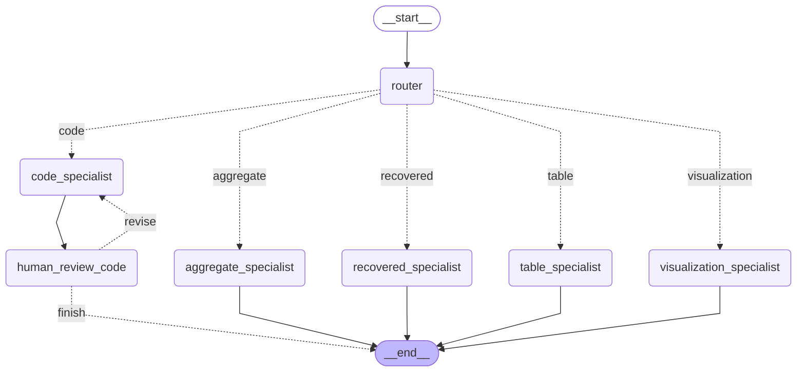
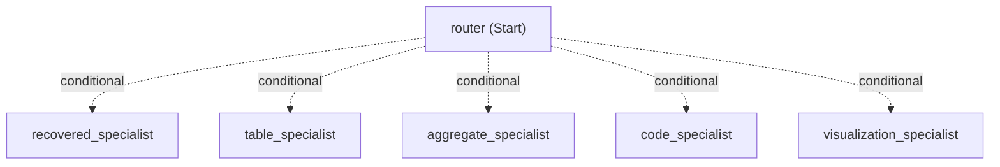
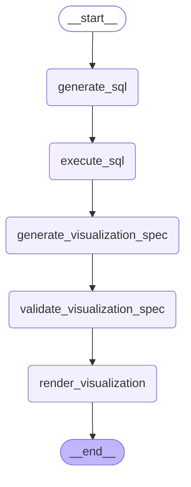
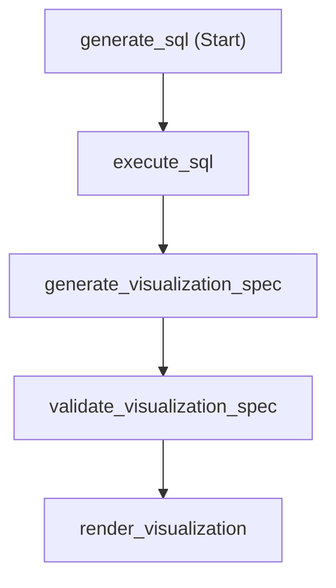
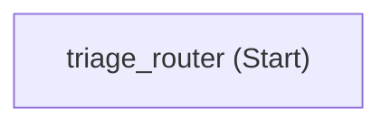

# Pandas Analytics Agents

This repo contains two versions of implemtation of an agentic workflow that is able to answer a user's analytical questions against a COVID-19 dataset (see ["Dataset"](#dataset) section below), one in LangGraph and one in Micorosoft Agent Framework (MAF).

The workflow consists of a triage router and five specialist agents: aggregate specialist, recovered specialist, table specialist, code specialist, and visualization specialist. This is called **main workflow** (see ["Main Workflow"](#main-workflow) under ["Workflow Topology"](#workflow-topology))

When a user question is submitted to it, the workflow starts with the router and forwards the user question to it. The router routes the control to one of the five specialist based on the question. After a specialist answers a question, the workflow stops. So, all five specialist agents are terminal nodes in the workflow.

The assignment of user questions to specialists is listed below:

\- Specialist: "_aggregate_"<br/>
Question Type: "aggregate", a single value (str or numerical) answer is expected<br/>
Example Question: Which country has reported the largest number of deaths of COVID-19?

\- Specialist: "_recovered_"<br/>
Question Type: "recovered", there is only a single question of this type listed below<br/>
Example Question (only one): Which country reported the largest number of recovered cases?<br/>

\- Specialist: "_table_"<br/>
Question Type: "table", a list of records is expected in answer<br/>
Example Question: Which countries have reported more than 10000 death cases?<br/>

\- Specialist: "_code_"<br/>
Question Type: "code", asking for source code generation<br/>
Example Question: Show me Pandas code to show the schema of the covid_19 dataset.<br/>

\- Specialist: "_visualization_"<br/>
Question Type: "visualization", asking for plotting a relationship or distribution<br/>
Example Question: Plot the top 10 countries by COVID-19 deaths.<br/>

Among these five specialists, "recovered" specialist can be seen as a special "aggregate" specialist that is responsible to answer exclusively this single question: "Which country reported the largest number of recovered cases?". So, this specialist is redundant. Indeed, this question can be answered by "aggregate" specialist. The reason I include this specialist is to demonstrate what you need to pay attention to and what happens when you have tools and agents that overlap in functionality (may be due to poor design or speical business needs).

"code" specialist is another interesting agent. It contains a Human-In-The-Loop (**HITL**) step. It works as a simplest coding agent: it first generates source code for a coding question; then it enters a code review process that leads to either code rejection or acceptance; if the code is accepted, the workflow stops; otherwise, the agent will generate new code and ask for code review again. In total, up to three code generation attempts will be allowed. This is depicted as a small closed loop from "code_specialist" to "human_review_code", and back to "code_specialist" via an edge marked as "revise", which can be seen in the leftmost path in ["Main Workflow"](#main-workflow) under ["Workflow Topology"](#workflow-topology) section.

"visualization" specialist is itself a deterministic workflow, called "**visualization workflow**", consisting of the following five steps: generate_sql, execute_sql, generate_visualization_spec, validate_visualization_spec, and render_visualization. It can run standalone or as a sub-workflow/-graph of the main workflow. See ["Visualization Workflow"](#visualization-workflow) under ["Workflow Topology"](#workflow-topology) below for reference.

In summary, the agentic workflow implemented in this repo consists of a main workflow, which comprises five specialists: aggregate, recovered, table, code, and visualization, which is a deterministic workflow itself.

## Workflow Topology

### Main Workflow

This is generated from main workflow implementation in LangGraph:



Tip: You can view the topology in a PNG image using the following link if the above mermaid is not rendered:
[Main Workflow Topology in PNG](https://github.com/lichtjiang/pandas-analytics-agents/blob/master/images/main_workflow_diagram_langchain.png)

In comparison, the following is generated from v3 implementation in MAF (see ["MAF Main Workflow"](#maf-main-workflow) section below):



### Visualization Workflow

This is generated from main workflow implementation in LangGraph:



Tip: You can view the topology in a PNG image using the following link if the above mermaid is not rendered:
[Visualization Workflow Topology in PNG](https://github.com/lichtjiang/pandas-analytics-agents/blob/master/images/visualization_subgraph_diagram_langchain.png)

In comparison, the following is generated from v3 implementation in MAF (see ["MAF Main Workflow"](#maf-main-workflow) section for different versions of main workflow implementation in MAF):



## Dataset

The dataset used for this project, originally named "country_wise_latest.csv", was sourced from Kaggle.

[https://www.kaggle.com/datasets/imdevskp/corona-virus-report/data?select=country_wise_latest.csv](https://www.kaggle.com/datasets/imdevskp/corona-virus-report/data?select=country_wise_latest.csv)

It contains country-level data such as the following, as of 2020:

– Confirmed cases

– Deaths

– Recoveries

– Active cases

I renamed the file to "covid19_country_wise_latest.csv" to make it clear that this is covid19 data.

Original data set is titled "JHU CSSE COVID-19 Data", from which the above csv file is created, hosted on GitHub here:

[https://github.com/CSSEGISandData/COVID-19](https://github.com/CSSEGISandData/COVID-19)

The data set is licensed under the Creative Commons Attribution 4.0 International (CC BY 4.0) by the Johns Hopkins University on behalf of its Center for Systems Science in Engineering. Copyright Johns Hopkins University 2020.

## LangGraph Workflow

### Main Workflow

See ["Main Workflow"](#Main-Workflow) under ["Workflow Topology"](#workflow-topology) from above.

### Visualization Workflow

See ["Visualization Workflow"](#visualization-workflow) under ["Workflow Topology"](#workflow-topology) shown above.

## MAF Workflow

### MAF Main Workflow

Unlike LangGraph version, there are three versions of main workflow built with MAF:

- main_workflow_maf_v1.py
- main_workflow_maf_v2.py
- main_workflow_maf_v3.py

All three versions support running from CLI and with DevUI (see ["DevUI/Local WebUI Playground for MAF Workflow"](#devuilocal-webui-playground-for-maf-workflow) section below).

**main_workflow_maf_v1.py**: only triage router is implemented as an Executor, named "TriageExecutor". Other five specilist are executed via agent.run() inside the handler of TriageExecutor. So, the topology of this implementation of the main workflow looks like the following (a single node workflow):



**main_workflow_maf_v2.py**: a typical triage/router workflow with mulitple executors (nodes). That is, in addition to the router, all five specialists are also implemented as executors. Here's a screenshot of DevUI that shows the topology of this main workflow:


**main_workflow_maf_v3.py**: same as v2 but with one difference in how HILT is handled. v2 implements HILT as a simple loop that wraps "input()" while v3 pauses "code" specialist and surfaces a "request_info" for a user to review the code and send back a feedback, upon which the "code" specialist decides whether to reattempt code generation or stop. This results in a big difference how you would interact with the workflow when asking for code generation using DevUI.

With v2, after you ask a coding question on DevUI web page, you have to leave the browser and go back to the terminal where the workflow script is launched to either accept or reject generated source code. This is inconvenient.

In contrast, v3 allows you to stay on DevUI webpage throughout the whole workflow, from entering a coding question to HITL review process. Here's a screenshot of DevUI that shows this when the code executor is paused for human code review during HITL:


And here is a DevUI screenshot after the user accepted the code and entered "PASS":


#### DevUI/Local WebUI Playground for MAF Workflow

DevUI is a lightweight web application for running and debugging agents and workflows built with the MAF.

- Interactive Testing: You can chat with your agents and workflows in a web UI, send inputs, and see outputs immediately.
- Workflow Execution & Inspection: You can enter a prompt, and watch the entire execution flow. DevUI shows you which executors were invoked and when, which is especially useful for debugging complex multi-agent or fan-out/fan-in patterns.
- Trace Viewing: When tracing is enabled, DevUI collects and displays OpenTelemetry spans. This lets you see the internal steps your workflow took, including timing and token usage, helping you pinpoint where things went wrong or understand the execution path

OpenTelemetry instrumentation/reporting is explicitly enabled in v3 (See "OTel Spans" tab in the rightmost panel of above DevUI Web UI screenshot for OpenTelemetry metrics).

Here is a screenshot that shows number of tokens incurred by the workflow to answer the question: "Which country has reported the largest number of deaths of COVID-19?":


#### OpenTelemetry Tracking with Aspire for MAF Workflow

The Aspire Dashboard is a sophisticated tool for comprehensive app monitoring and inspection that can be used during local development/testing, and in production. It provides a web-based UI that collects and displays logs, traces, and metrics in real-time, offering an intuitive way to view structured telemetry data.

While it's integrated into .NET Aspire projects, it can also run in standalone mode via a Docker container. This makes the Aspire Dashboard a perfect tool for local development observability when building workflows with MAF.

Here's what you can do with it:

1\. Trace Workflow Execution

You can visualize the complete execution flow of your agent or workflow. The dashboard shows you:

- The top-level invoke_agent span for each agent invocation
- Child spans for each LLM call (chat <model_name>) and tool execution (execute_tool <function_name>)
- The timing of each operation, helping you identify bottlenecks

This screenshot shows trace detail of one run of visualization workflow:


2\. Monitor Token Usage

The dashboard displays metrics like gen_ai.client.token.usage, which tracks input and output token counts. This is invaluable for cost tracking and optimization.


3\. View Structured Logs

You can see logs emitted during workflow execution, which helps with debugging and understanding the sequence of events .


4\. Measure Performance

Metrics such as gen_ai.client.operation.duration and agent_framework.function.invocation.duration let you monitor the latency of each operation and function execution.


OpenTelemetry instrumentation/reporting is explicitly enabled in main_workflow_maf_v3.py and visualization_specialist_maf.py. 

What this means is the following explicit call in the script:

```python
from agent_framework.observability import configure_otel_providers
configure_otel_providers(enable_sensitive_data=True)
```
It does two things:

  1. Enables/configures Agent Framework instrumentation.
  2. Creates the trace, metric, and log exporters using the OTEL environment variables.

Note though, `enable_sensitive_data=True` is not required for ordinary traces and metrics. It enables potentially sensitive content such as prompts, responses, tool arguments, and results. Use it only in development or other trusted environments.

Together with this call, we also need to export the following two environment variables in order to specify the OTLP destination and protocol (They do not, by themselves, universally guarantee that an OpenTelemetry provider/exporter has been initialized.):

```bash
OTEL_EXPORTER_OTLP_ENDPOINT=http://localhost:4317
OTEL_EXPORTER_OTLP_PROTOCOL=grpc
```

So, theoretically, we can only run these two workflow scripts to view their OpenTelemetry data.

However, in the current Agent Framework version, instrumentation is enabled by default and the framework may automatically configure its observability providers when it detects the OTEL environment variables. That is why the workflow can report telemetry without an explicit call to configure_otel_providers() in the code.

But this behavior is version- and integration-dependent. The explicit call shown above remains the most reliable application-level configuration.

Thus, recommended practice:

```python
from agent_framework.observability import configure_otel_providers
configure_otel_providers()
```

with the OTEL variables supplied externally. Add `enable_sensitive_data=True` only when you intentionally want model input/output content captured.

Bottomline is: two OTEL variables may be sufficient with certain MAF version and execution path, but they are not the complete, portable configuration contract. Explicitly configuring providers is clearer and more robust.

Based on this dicussion, you will find you may be able to monitor all three versions of MAF main workflows (v1, v2, v3), and visualization workflow using Aspire Dashboard by simply running them with the two OTEL variables in the environment.

## Prerequisites

- Deployed models on Microsoft Foundry

	This is required if you want to run the code as is. If you don't have an Azure account or you don't want to pay for a Foundry model, you can modify the code to replace it with any model you have access to.

- Python package and project manager: `uv`
- Project dependencies
```toml
Project dependencies = [
    "agent-framework>=1.19.0",
    "dotenv>=0.9.9",
    "duckdb>=1.5.6",
    "grandalf>=0.8",
    "langchain>=1.4.3",
    "langchain-openai>=1.6.6",
    "langgraph>=1.2.12",
    "matplotlib>=3.11.2",
    "opentelemetry-exporter-otlp-proto-grpc>=1.44.0",
    "pandas>=3.0.6",
    "pydantic>=2.13.5",
    "seaborn>=0.13.2",
]
```

- Project dev dependencies: `iPython`

So, you can play with the dataset.

- Docker Desktop
[https://www.docker.com/products/docker-desktop/](https://www.docker.com/products/docker-desktop/)

- Aspire Dashboard Docker image
  
`mcr.microsoft.com/dotnet/aspire-dashboard:latest`


## Project Structure

```text
.
├── README.md
├── aspire.env
├── images
│   ├── Aspire_visualization_workflow_metrics.png
│   ├── Aspire_visualization_workflow_structured-log.png
│   ├── Aspire_visualization_workflow_tokenusages.png
│   ├── Aspire_visualization_workflow_traces.png
│   ├── DevUI-tokenusages_main_workflow_maf_v3.png
│   ├── DevUI_HITL-done_OTel_main_workflow_maf_v3.png
│   ├── DevUI_HITL-paused_main_workflow_maf_v3.png
│   ├── DevUI_main_workflow_maf_v2.png
│   ├── main_workflow_diagram_langchain.png
│   ├── visualization.png
│   └── visualization_subgraph_diagram_langchain.png
├── pyproject.toml
├── src
│   └── pandas_analytics_agents
│       ├── __init__.py
│       ├── dataset
│       │   └── covid19_country_wise_latest.csv
│       ├── main_workflow
│       │   ├── __init__.py
│       │   ├── langchain
│       │   │   ├── __init__.py
│       │   │   └── main_workflow_langchain.py
│       │   └── maf
│       │       ├── __init__.py
│       │       ├── main_workflow_maf_v1.py
│       │       ├── main_workflow_maf_v2.py
│       │       └── main_workflow_maf_v3.py
│       ├── subgraph
│       │   ├── __init__.py
│       │   ├── langchain
│       │   │   ├── __init__.py
│       │   │   └── visualization_specialist_langchain.py
│       │   └── maf
│       │       ├── __init__.py
│       │       └── visualization_specialist_maf.py
│       └── utils
│           ├── __init__.py
│           ├── dataset.py
│           ├── duckdb.py
│           ├── langchain
│           │   ├── __init__.py
│           │   ├── generate_main_workflow_diagram_langchain.py
│           │   └── generate_visualization_subgraph_diagram_langchain.py
│           └── maf
│               ├── __init__.py
│               ├── generate_main_workflow_v1_diagram_maf.py
│               ├── generate_main_workflow_v2_diagram_maf.py
│               ├── generate_main_workflow_v3_diagram_maf.py
│               └── generate_visualization_subgraph_diagram_maf.py
└── uv.lock

```

## How to Run

### Get Familiar with COVID-19 Dataset

Install `iPython` as a dev dependency.

Dataset is a small csv file "dataset/covid19_country_wise_latest.csv". Familiarize yourself with the dataset by loading it in `iPython` and play with it. For example, try to answer each of the following test questions using `Pandas` (and `matplotlib` if needed).

### Test Questions

1\. "aggregate" question
Which country has reported the largest number of deaths of COVID-19?

2\."recovered" question (only one)
Which country reported the largest number of recovered cases?

3\."table" question
Which countries have reported more than 10000 death cases?

4\."code" question
Show me Pandas code to show the schema of the covid_19 dataset.

5\."visualization" question
Plot the top 10 countries by COVID-19 deaths.


### Clone the Repository

git clone https://github.com/lichtjiang/pandas-analytics-agents.git

### Dependency Installation and Editable Installs

`cd pandas-analytics-agents`

`uv sync`

To install the current project as an editable package (optional)

`uv pip install -e .`

Note: `setuptools` is used here for educational purposes, as it makes `pyproject.toml` easier for newcomers to `uv` to read. If you'd prefer to use `uv_build` instead, follow these steps:

  1. Update [build-system] in pyproject.toml:
```toml
  [build-system]
  requires = ["uv_build>=0.12.23,<0.13"]
  build-backend = "uv_build"
```
  Use a version range compatible with the uv version you standardize on. The upper bound is
  recommended by uv’s latest documentation, "The uv build backend":
  (https://docs.astral.sh/uv/configuration/build-backend/)

  2. Remove the setuptools-specific sections:
```toml
  [tool.setuptools.packages.find]
  where = ["src"]

  [tool.setuptools.package-data]
  pandas_analytics_agents = ["dataset/covid19_country_wise_latest.csv"]
```
  uv_build automatically discovers the package at:

  `src/pandas_analytics_agents/`

  The package name matches the normalized project name, and the directory contains `__init__.py`.

  3. Keep the CSV where it is:

  `src/pandas_analytics_agents/dataset/covid19_country_wise_latest.csv`

  Because it is inside the package directory, uv_build includes it in the wheel automatically. You should not need a replacement for the existing package-data configuration.

  4. Verify that package code accesses the file as package data rather than through a repository-relative path. For example, prefer `importlib.resources` (see `load_covid_dataset()` in `dataset.py` for example code):
```python
  from importlib.resources import files

  csv_path = files("pandas_analytics_agents").joinpath(
      "dataset/covid19_country_wise_latest.csv"
  )
```
  5. Re-lock dependencies if needed:

  `uv lock`

  6. Build the distributions:

  `uv build`

  7. Inspect the artifacts:

  `unzip -l dist/*.whl`
  `tar -tf dist/*.tar.gz`

  Confirm that the package modules and CSV are included.

  8. For a publishing-oriented verification, build without uv-specific sources:

  `uv build --no-sources`

  The existing `src/pandas_analytics_agents.egg-info` directory is generated metadata from `setuptools` (not shown in project tree above) and should not be relied on by `uv_build`; remove it only if it is tracked or recreated as part of your project workflow.

### Set Up `.env`

Refer to `.env.template`, copy it to `.env` and set up variables such as MS Foundry settings as needed.

### Run LangGraph Workflow
#### Run Main Workflow

`uv run src/pandas_analytics_agents/main_workflow/langchain/main_workflow_langchain.py`

#### Run Visualization Workflow

Since visualization itself is a workflow, we can run it alone against plotting requests.

`uv run src/pandas_analytics_agents/subgraph/langchain/visualization_specialist_langchain.py`

### Run MAF Workflow

#### Run Single Executor Workflow

From CLI:

`uv run src/pandas_analytics_agents/main_workflow/maf/main_workflow_maf_v1.py`

From DevUI (find the DevUI login token from the output log):

`uv run src/pandas_analytics_agents/main_workflow/maf/main_workflow_maf_v1.py --dev`

#### Run Multi-Executor Workflow

From CLI:

`uv run src/pandas_analytics_agents/main_workflow/maf/main_workflow_maf_v2.py`

`uv run src/pandas_analytics_agents/main_workflow/maf/main_workflow_maf_v3.py`

From DevUI but HITL still works in CLI (DevUI login token is: `hello_token_321`):

`uv run src/pandas_analytics_agents/main_workflow/maf/main_workflow_maf_v2.py --dev`

From DevUI with HITL inside DevUI (DevUI login token is: `hello_token_321`):

`uv run src/pandas_analytics_agents/main_workflow/maf/main_workflow_maf_v3.py --dev`

#### Run with Aspire Dashboard

As I have mentioned previously, `main_workflow_maf_v3.py` and `visualization_specialist_maf.py` are explicitly configured for OpenTelemetry instrumentation/report. But in the current version of MAF for this project, we can simply export the two OTEL varaiables and then run all MAF workflow scripts to use Aspire Dashboard for monitoring and tracing. Note though, if you run these scripts with an older MAF version, you may need to enable instrumentation/report in your code.

Start Docker Desktop.

Start Aspire Dashboard container:

`docker run --rm -it -p 18888:18888 -p 4317:18889 -p 4318:18890 -d --name aspire-dashboard mcr.microsoft.com/dotnet/aspire-dashboard:latest`

Next, in Docker Desktop, click on the container named “aspire-dashboard” to open its logs, find a line like the following:

```text
http://localhost:18888/login?t=06553f5b463d92161a996e7c2e7d4a8c
```

Copy and paste the above URL to a browser to open the Aspire Dashboard.

Open a terminal, change to the project root, set up two environment variables:

`export OTEL_EXPORTER_OTLP_ENDPOINT=http://localhost:4317`

`export OTEL_EXPORTER_OTLP_PROTOCOL=grpc`

These two commands are also saved in `aspire.env` file in the project root.

Finally, in the same terminal, run our workflows from the project root:

`uv run src/pandas_analytics_agents/main_workflow/maf/main_workflow_maf_v1.py`

`uv run src/pandas_analytics_agents/main_workflow/maf/main_workflow_maf_v2.py`

`uv run src/pandas_analytics_agents/main_workflow/maf/main_workflow_maf_v3.py`

or

`uv run src/pandas_analytics_agents/main_workflow/maf/main_workflow_maf_v1.py --dev`

`uv run src/pandas_analytics_agents/main_workflow/maf/main_workflow_maf_v2.py --dev`

`uv run src/pandas_analytics_agents/main_workflow/maf/main_workflow_maf_v3.py --dev`

and

`uv run src/pandas_analytics_agents/subgraph/maf/visualization_specialist_maf.py`

Now, you can go to `http://localhost:18888` and start to view logs, traces and metrics.

### View Visualization Specialist/Workflow Result
"visualization workflow" can run standalone or as a sub-workflow. That means, you can either run `uv run src/pandas_analytics_agents/subgraph/maf/visualization_specialist_maf.py` or run main workflow v1, v2, or v3 and ask for plotting something. Either way, a png file `visualization.png` containing the visualization will be created in `outputs` subfolder of the project root.

### Generate Workflow Topology

The following command will print out the main workflow topology as an ASCII art and mermaid, and then save `main_workflow_diagram_langchain.png` in `outputs` subfolder of the project root.

`uv run src/pandas_analytics_agents/utils/langchain/generate_main_workflow_diagram_langchain.py`

The following command will print out the visualization topology as an ASCII art and mermaid, and then save `visualization_subgraph_diagram_langchain.png` in `outputs` subfolder of the project root.

`uv run src/pandas_analytics_agents/utils/langchain/generate_visualization_subgraph_diagram_langchain.py`

